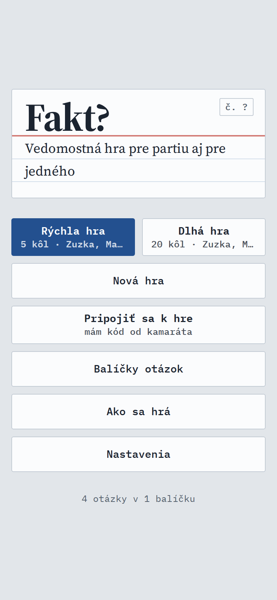
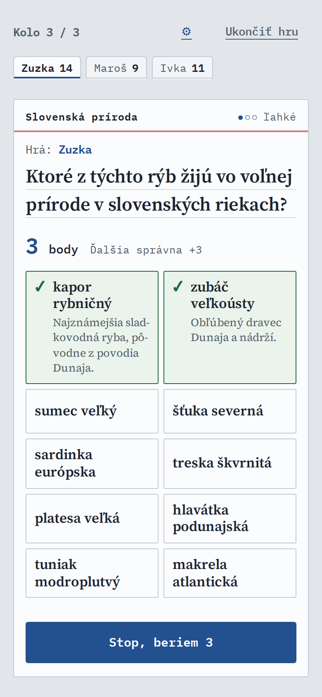
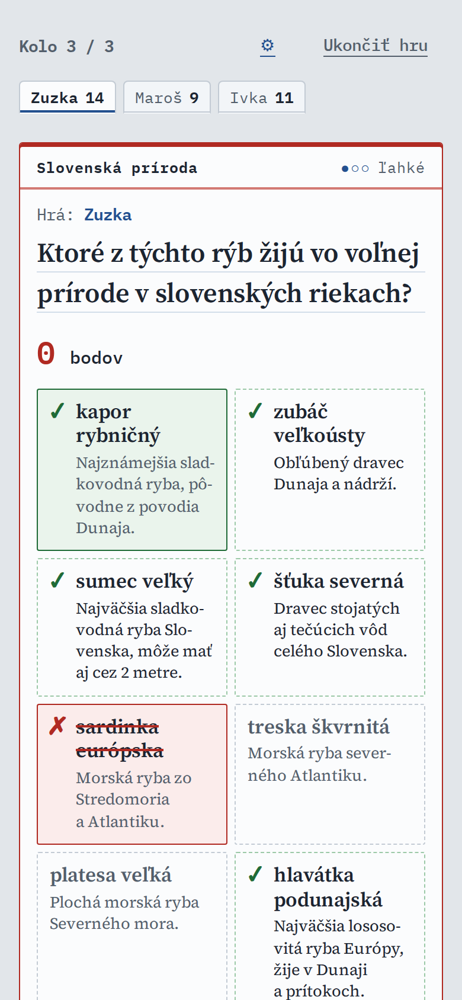
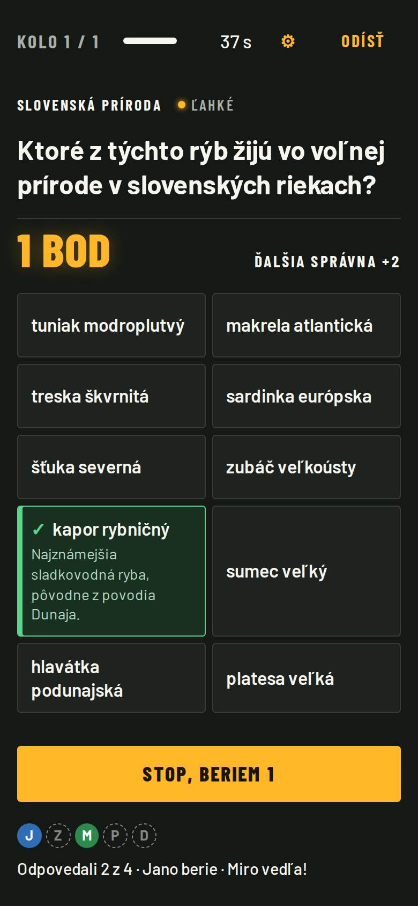
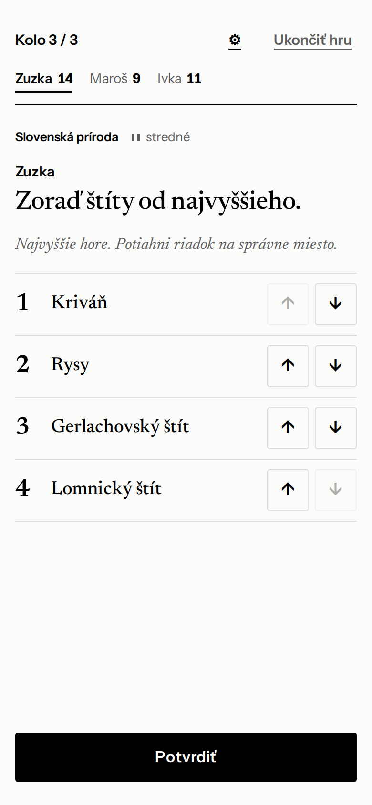
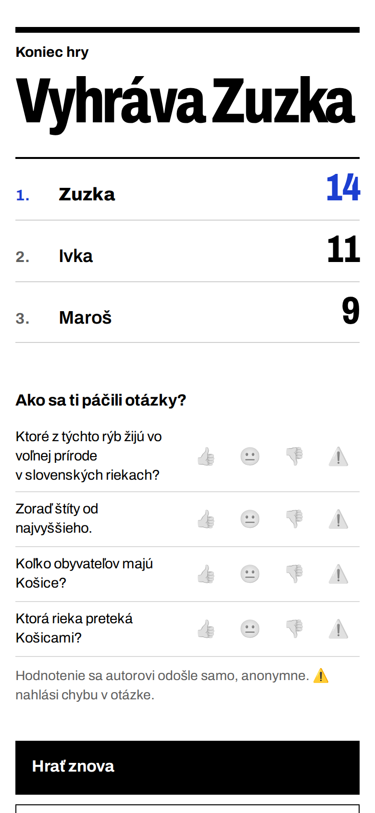
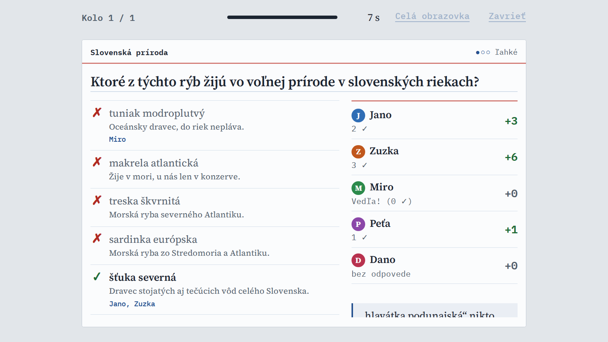

<h1 align="center">Fakt?</h1>

<p align="center">
  <b>A free Slovak quiz game for a group of friends: one phone passed around the table, or everyone on their own phone with a TV as the big screen.</b><br>
  No accounts, no ads, nothing to buy. Plays offline once loaded.
</p>

<p align="center">
  <a href="https://fakt.hutnan.dev"><b>▶ Play at fakt.hutnan.dev</b></a>
</p>

<p align="center">
  
  
  
  
</p>

## How it plays

Each card asks a question and shows ten options, two to eight of them true. Tap the ones you believe are
true: the first correct pick is worth 1 point, the second 2, the third 3 and so on. Stop whenever you like
and keep the points, or keep going and risk it all: one wrong pick wipes the card. After your turn the
answer is drawn on the same grid, with a one-line explanation for every option, so a wrong guess is
something to laugh about rather than just a red cross.

**Mix** (the default) adds other formats: put items in order, guess a number, one of four, and "which
is more?". **Klasika** is ten-option cards only.

- **One phone**: players pass it around, with a hand-over screen so nobody sees the previous answer.
- **Rooms**: everyone answers the same card at once on their own phone (join by QR code, link or a
  four-letter code, also remotely). A TV or laptop can join as a read-only big screen that fits the
  window and scrolls long lists by itself; the host can pause on the answers to talk them through.
- **Catch-up rules**: every third round the player in last place picks the pack of the next card; a
  shared lead at the end goes to a tie-break number question. After each card the game remarks on who
  fell for what, and the end of the game hands out titles.
- **Questions**: 30+ packs with 800+ questions, mostly Slovak: nature, towns, history, rap and pop,
  film and TV, sport, food, language, conspiracy theories, cocktails, world records and more. Packs can be
  switched off by topic; niche packs are opt-in and adult packs (18+) are off by default and labelled.
- **Your own packs**: import a YAML or JSON pack; it stays in your browser.
- **Feedback from the table**: rate each card 👍 / 😐 / 👎 after a game, or report a mistake on any card.
  Ratings and reports go to the author anonymously, without leaving the game.
- **Four designs** (three with light and dark modes, Tabuľa always dark), switchable during a game.

<p align="center">
  
  
</p>
<p align="center">
  
</p>

## Question packs

Packs are YAML files in [`packs/`](packs/), one per topic, released under **CC0**. Every question cites a
source, every option has a one-line explanation, and time-sensitive facts carry the date they were true.
Questions are written for this game (never copied from other quizzes), drafted with the help of language
models, and checked against their sources before they are merged. The format and the writing guide are in
[`packs/README.md`](packs/README.md).

Found a wrong fact? Use **Nahlásiť chybu** under the card in the game, or open an issue.

## Develop

```sh
npm install
npm run dev          # builds packs, starts Vite
npm test             # engine and validator tests
npm run packs:check  # validate question packs
npm run build        # production build to dist/
npm start            # Node server: serves dist/ and runs rooms (PORT, default 8080)
```

`npm run dev` forwards room sockets (`/ws`) to `npm start` on port 8080, so run both to try rooms.

- `src/engine/` – game rules as pure functions (seeded decks, scoring, reducer)
- `src/content/` – pack format and validation
- `src/ui/` – Preact screens
- `src/designs/` – switchable visual designs (`?design=<id>`, gallery at `#designs`)
- `src/server/` – Node server for the container: serves `dist/` and runs rooms over WebSocket
- `src/net/` – room protocol and the reconnecting browser client
- `packs/` – question packs in YAML; see `packs/README.md` for the format and writing guide

Play tests and screenshots (with `npx vite preview --port 4174` running): `node scripts/e2e.ts http://localhost:4174/`,
`BASE_URL=http://localhost:4174/ node scripts/screenshots.ts <dir>` (every design and screen), `node scripts/readme-screenshots.ts http://localhost:4174/` (the images above).

## Deploy

Every push to `main` publishes `ghcr.io/tomashutnan/fakt` (amd64 and arm64), tagged `latest` and by
commit (`sha-1a2b3c4`). The image holds the built app and the server that serves it and runs the rooms on port 8080,
with `/healthz` for health checks. The server runs from TypeScript through Node's type stripping;
its only dependency is `ws`. Rooms live in memory and are written to `/data/rooms.json` on shutdown,
so a restart or update does not end running games. Limits (rooms, connections, pack memory, room
lifetime) are set in `.env`; see `.env.example`.

`compose.vps.yaml` runs it behind caddy-docker-proxy on the shared `web` network:

```sh
mkdir ~/fakt && cd ~/fakt
curl -fsSLo compose.yaml https://raw.githubusercontent.com/TomasHutnan/fakt/main/compose.vps.yaml
curl -fsSLo .env https://raw.githubusercontent.com/TomasHutnan/fakt/main/.env.example
sudo install -d -o 1000 -g 1000 /home/deploy/data/fakt
nano .env
docker compose up -d
```

Update with `docker compose pull && docker compose up -d`; roll back by setting `FAKT_IMAGE_TAG`.
Try the image locally with `docker build -t fakt . && docker run --rm -p 8080:8080 fakt`.

## Licence

Code: [MIT](LICENSE). Question packs: CC0-1.0 unless a pack says otherwise.
